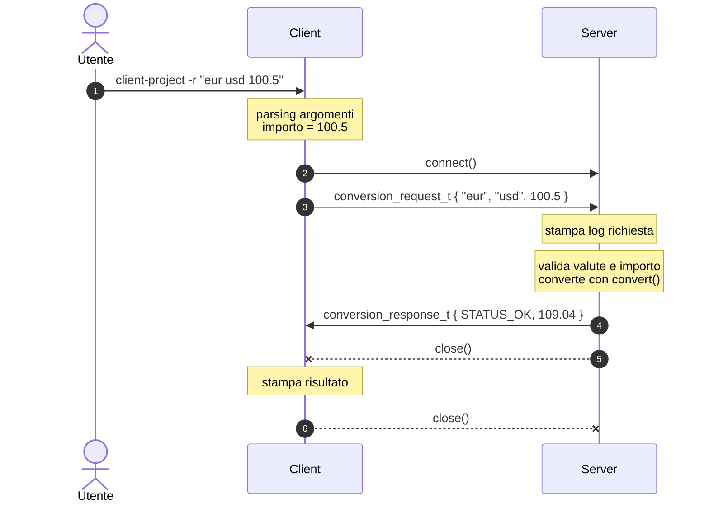

# Primo Esonero di Laboratorio - Reti di Calcolatori (ITPS A-K) a.a. '26-27

## Obiettivo

Implementare un'applicazione TCP client/server in cui il server è un **convertitore di valute**.

La specifica è data da tre elementi, da leggere insieme:

1. il file [`protocol.h`](client-project/src/protocol.h) (già fornito, **non modificare** le definizioni);
2. il diagramma di sequenza;
3. la tabella degli esempi, che fa fede per il formato di input e output.

## 1. Protocollo

Le strutture `conversion_request_t` e `conversion_response_t`, i codici di stato e le costanti sono definiti in [`protocol.h`](client-project/src/protocol.h). Client e server si scambiano queste strutture rispettando queste regole:

- l'importo è un `float`: nel campo `amount` viaggiano i suoi 32 bit (vedi lezione *Costruzione di messaggi*);
- i campi `uint32_t` vanno convertiti in **network byte order** prima dell'invio e riconvertiti dopo la ricezione;
- in caso di errore (`status != STATUS_OK`) il server invia `amount = 0`;
- i codici valuta sono accettati senza distinzione tra maiuscole e minuscole: il client li invia come ricevuti e li stampa in maiuscolo, il server li riporta nel log come ricevuti.

## 2. Diagramma di sequenza



Il server serve un client alla volta e non termina mai.

## 3. Conversione (server)

Il server conosce le valute della tabella, con tassi fittizi rispetto all'euro. Per ogni valuta, la colonna **1 EUR =** dice quante unità di quella valuta vale 1 euro:

| Code | 1 EUR = |
|---|---|
| `EUR` | 1 EUR |
| `USD` | 1.085 USD |
| `GBP` | 0.855 GBP |
| `CHF` | 0.945 CHF |
| `JPY` | 162 JPY |
| `CAD` | 1.48 CAD |
| `AUD` | 1.65 AUD |
| `CNY` | 7.8 CNY |

Ricevuta una richiesta `FROM TO importo`, il server esegue **in quest'ordine** i controlli:

1. cerca `FROM` e `TO` nella tabella, senza distinguere maiuscole e minuscole (`eur` e `EUR` sono la stessa valuta). Se uno dei due manca → `STATUS_INVALID_CURRENCY`;
2. se `importo` non è compreso tra 0 (escluso) e `MAX_AMOUNT` (incluso) → `STATUS_INVALID_AMOUNT`;
3. altrimenti risponde `STATUS_OK` con l'importo convertito:

   **risultato = importo × tasso(TO) / tasso(FROM)**

   Esempio: 100.5 EUR → USD = 100.5 × 1.085 / 1 = 109.04 USD

Per la tabella e il calcolo usate **esattamente** questo codice:

<!-- codice-imposto -->
```c
typedef struct {
    const char *code;
    double rate;    // 1 EUR = rate units of this currency
} rate_t;

static const rate_t RATES[] = {
    {"EUR", 1.0},   {"USD", 1.085}, {"GBP", 0.855}, {"CHF", 0.945},
    {"JPY", 162.0}, {"CAD", 1.48},  {"AUD", 1.65},  {"CNY", 7.8},
};

/*
 * Converts an amount from one currency to another.
 * Example: 100.5 EUR -> USD is convert(100.5f, 1.0, 1.085) = 109.04 USD
 */
float convert(float amount, double rate_from, double rate_to) {
    return (float)(amount * rate_to / rate_from);  // double math: same result on every machine
}
```

## 4. Interfaccia da riga di comando

```
client-project [-s server] [-p port] -r "FROM TO importo"
server-project [-p port]
```

| Opzione | Default |
|---|---|
| `-s` | `DEFAULT_SERVER_IP` |
| `-p` | `SERVER_PORT` |

## 5. Esempi

Server avviato con `server-project`. La colonna **Log server** riporta l'output del server per la stessa richiesta.

| `-r` | Output client | Log server |
|---|---|---|
| `"EUR USD 100"` | `Ricevuto risultato dal server ip 127.0.0.1. 100.00 EUR = 108.50 USD` | `Richiesta 'EUR USD 100.00' dal client ip 127.0.0.1` |
| `"eur usd 100.5"` | `Ricevuto risultato dal server ip 127.0.0.1. 100.50 EUR = 109.04 USD` | `Richiesta 'eur usd 100.50' dal client ip 127.0.0.1` |
| `"USD EUR 100"` | `Ricevuto risultato dal server ip 127.0.0.1. 100.00 USD = 92.17 EUR` | `Richiesta 'USD EUR 100.00' dal client ip 127.0.0.1` |
| `"GBP JPY 1000"` | `Ricevuto risultato dal server ip 127.0.0.1. 1000.00 GBP = 189473.69 JPY` | `Richiesta 'GBP JPY 1000.00' dal client ip 127.0.0.1` |
| `"JPY EUR 5000"` | `Ricevuto risultato dal server ip 127.0.0.1. 5000.00 JPY = 30.86 EUR` | `Richiesta 'JPY EUR 5000.00' dal client ip 127.0.0.1` |
| `"CHF CHF 12.34"` | `Ricevuto risultato dal server ip 127.0.0.1. 12.34 CHF = 12.34 CHF` | `Richiesta 'CHF CHF 12.34' dal client ip 127.0.0.1` |
| `"EUR USD 100000"` | `Ricevuto risultato dal server ip 127.0.0.1. 100000.00 EUR = 108500.00 USD` | `Richiesta 'EUR USD 100000.00' dal client ip 127.0.0.1` |
| `"EUR XYZ 10"` | `Ricevuto risultato dal server ip 127.0.0.1. Valuta non supportata` | `Richiesta 'EUR XYZ 10.00' dal client ip 127.0.0.1` |
| `"XYZ USD 0"` | `Ricevuto risultato dal server ip 127.0.0.1. Valuta non supportata` | `Richiesta 'XYZ USD 0.00' dal client ip 127.0.0.1` |
| `"EUR USD -5"` | `Ricevuto risultato dal server ip 127.0.0.1. Importo non valido` | `Richiesta 'EUR USD -5.00' dal client ip 127.0.0.1` |
| `"EUR USD 0"` | `Ricevuto risultato dal server ip 127.0.0.1. Importo non valido` | `Richiesta 'EUR USD 0.00' dal client ip 127.0.0.1` |
| `"EUR USD 100000.01"` | `Ricevuto risultato dal server ip 127.0.0.1. Importo non valido` | `Richiesta 'EUR USD 100000.01' dal client ip 127.0.0.1` |

Se `-r` manca o il suo argomento non è nel formato `"FROM TO importo"` (codice valuta non composto da 3 lettere, importo non numerico, campi mancanti o in più), il client **non contatta il server**, stampa

```
Uso: client-project [-s server] [-p port] -r "FROM TO importo"
```

ed esce con codice di uscita diverso da 0.

> [!WARNING]
> L'output deve corrispondere **carattere per carattere** a quello degli esempi: lingua italiana, spazi, punteggiatura, due cifre decimali, nessun messaggio aggiuntivo.
> Se il server non è raggiungibile o la risposta non è valida (codice di stato sconosciuto), il client stampa un errore ed esce con codice di uscita diverso da 0; in tutti gli altri casi esce con codice 0.

## 6. Requisiti

1. Il codice compila ed esegue su **Windows, Linux e macOS**, nei progetti Eclipse CDT forniti.
2. Il client è compatibile con il server di riferimento e il server con il client di riferimento, usati per la correzione.
3. Il codice è privo di buffer overflow, memory leak e comportamento indefinito.

## Consegna

- **Scadenza**: lunedì 30 novembre 2026, ore 23:59
- **Form di prenotazione / consegna**: [link](https://forms.gle/d7zivatYBT6uHMzU8) (Ctrl/Cmd-clic per aprire in una nuova scheda)
- **Formato**: link al repository GitHub **privato**, con l'utente `correttore-lab-reti` aggiunto come collaboratore in lettura (vedi README)
- **Risultati**: [link](https://collab-uniba.github.io/correzione_esonero_reti_tcp_itps_A-K_26-27/aggregate-report.html) (Ctrl/Cmd-clic per aprire in una nuova scheda)
- **Note**:
   - Una sola consegna per coppia
   - Non è necessario ricompilare il form di consegna dopo aggiornamenti al repository
   - La pagina dei risultati si aggiorna ogni ora

_Ver. 0.4.0_
