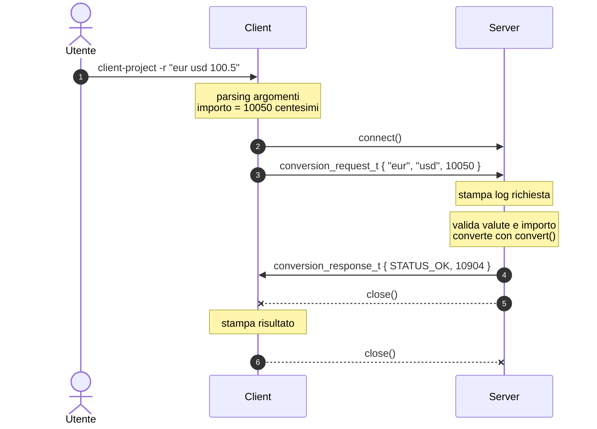

# Primo Esonero di Laboratorio - Reti di Calcolatori (ITPS A-K) a.a. '26-27

## Obiettivo

Implementare un'applicazione TCP client/server in cui il server è un **convertitore di valute**.

La specifica è data da quattro elementi, da leggere insieme:

1. il file [`protocol.h`](client-project/src/protocol.h) (già fornito, **non modificare** le definizioni);
2. il diagramma di sequenza;
3. il formato dei messaggi sul filo;
4. la tabella degli esempi, che fa fede per il formato di input e output.

## 1. Protocollo

Le strutture `conversion_request_t` e `conversion_response_t`, i codici di stato e le costanti sono definiti in [`protocol.h`](client-project/src/protocol.h). Gli importi viaggiano **in centesimi**, come interi senza segno a 32 bit.

## 2. Diagramma di sequenza



Il server serve un client alla volta e non termina mai.

## 3. Formato sul filo

I campi `uint32_t` viaggiano in **network byte order**.

**Richiesta (12 byte)**

| Offset | 0-3 | 4-7 | 8-11 |
|---|---|---|---|
| Campo | `from` | `to` | `amount` |
| Esempio `"eur usd 100.5"` | `65 75 72 00` | `75 73 64 00` | `00 00 27 42` |

**Risposta (8 byte)**

| Offset | 0-3 | 4-7 |
|---|---|---|
| Campo | `status` | `amount` |
| Esempio | `00 00 00 00` | `00 00 2A 98` |

In caso di errore (`status != STATUS_OK`) il server invia `amount = 0`.

## 4. Tassi di cambio e conversione (server)

Tassi fittizi rispetto a EUR, moltiplicati per 10000. Il server deve usare **esattamente** questa tabella e questa funzione:

```c
typedef struct {
    const char *code;
    uint32_t rate;   // units per 1 EUR, x10000
} rate_t;

static const rate_t RATES[] = {
    {"EUR",   10000}, {"USD",   10850}, {"GBP",   8550}, {"CHF",  9450},
    {"JPY", 1620000}, {"CAD",   14800}, {"AUD",  16500}, {"CNY", 78000},
};

uint32_t convert(uint32_t amount, uint32_t rate_from, uint32_t rate_to) {
    return (uint32_t)(((uint64_t)amount * rate_to + rate_from / 2) / rate_from);
}
```

## 5. Interfaccia da riga di comando

```
client-project [-s server] [-p port] -r "FROM TO importo"
server-project [-p port]
```

| Opzione | Default |
|---|---|
| `-s` | `DEFAULT_SERVER_IP` |
| `-p` | `SERVER_PORT` |

## 6. Esempi

Server avviato con `server-project`. La colonna **Log server** riporta l'output del server per la stessa richiesta.

| `-r` | Output client | Log server |
|---|---|---|
| `"EUR USD 100"` | `Ricevuto risultato dal server ip 127.0.0.1. 100.00 EUR = 108.50 USD` | `Richiesta 'EUR USD 100.00' dal client ip 127.0.0.1` |
| `"eur usd 100.5"` | `Ricevuto risultato dal server ip 127.0.0.1. 100.50 EUR = 109.04 USD` | `Richiesta 'eur usd 100.50' dal client ip 127.0.0.1` |
| `"USD EUR 100"` | `Ricevuto risultato dal server ip 127.0.0.1. 100.00 USD = 92.17 EUR` | `Richiesta 'USD EUR 100.00' dal client ip 127.0.0.1` |
| `"GBP JPY 1000"` | `Ricevuto risultato dal server ip 127.0.0.1. 1000.00 GBP = 189473.68 JPY` | `Richiesta 'GBP JPY 1000.00' dal client ip 127.0.0.1` |
| `"JPY EUR 5000"` | `Ricevuto risultato dal server ip 127.0.0.1. 5000.00 JPY = 30.86 EUR` | `Richiesta 'JPY EUR 5000.00' dal client ip 127.0.0.1` |
| `"CHF CHF 12.34"` | `Ricevuto risultato dal server ip 127.0.0.1. 12.34 CHF = 12.34 CHF` | `Richiesta 'CHF CHF 12.34' dal client ip 127.0.0.1` |
| `"EUR USD 100000"` | `Ricevuto risultato dal server ip 127.0.0.1. 100000.00 EUR = 108500.00 USD` | `Richiesta 'EUR USD 100000.00' dal client ip 127.0.0.1` |
| `"EUR XYZ 10"` | `Ricevuto risultato dal server ip 127.0.0.1. Valuta non supportata` | `Richiesta 'EUR XYZ 10.00' dal client ip 127.0.0.1` |
| `"XYZ USD 0"` | `Ricevuto risultato dal server ip 127.0.0.1. Valuta non supportata` | `Richiesta 'XYZ USD 0.00' dal client ip 127.0.0.1` |
| `"EUR USD 0"` | `Ricevuto risultato dal server ip 127.0.0.1. Importo non valido` | `Richiesta 'EUR USD 0.00' dal client ip 127.0.0.1` |
| `"EUR USD 100000.01"` | `Ricevuto risultato dal server ip 127.0.0.1. Importo non valido` | `Richiesta 'EUR USD 100000.01' dal client ip 127.0.0.1` |
| `"EURO USD 10"` | messaggio d'uso, exit code ≠ 0 | *(nessuna connessione)* |
| `"EUR USD 1.234"` | messaggio d'uso, exit code ≠ 0 | *(nessuna connessione)* |
| `"EUR USD 10,50"` | messaggio d'uso, exit code ≠ 0 | *(nessuna connessione)* |
| `"EUR USD -5"` | messaggio d'uso, exit code ≠ 0 | *(nessuna connessione)* |
| `"EUR USD"` | messaggio d'uso, exit code ≠ 0 | *(nessuna connessione)* |

> [!WARNING]
> L'output deve corrispondere **carattere per carattere** a quello degli esempi: lingua italiana, spazi, punteggiatura, due cifre decimali, nessun messaggio aggiuntivo su `stdout`.
> Se il server non è raggiungibile o la risposta non è valida, il client stampa un errore ed esce con exit code ≠ 0.

## 7. Requisiti

1. Il codice compila ed esegue su **Windows, Linux e macOS**, nei progetti Eclipse CDT forniti.
2. Il client è compatibile con il server di riferimento e il server con il client di riferimento, usati per la correzione.
3. Il codice è privo di buffer overflow, memory leak e comportamento indefinito.

## Consegna

- **Scadenza**: _TBD_
- **Form di prenotazione / consegna**: _TBD_
- **Formato**: link a repository GitHub accessibile pubblicamente, in uno dei seguenti formati:
    - https://github.com/<github-id>/cognome_matricola_esonero_reti_tcp_itps_A-K_26-27
    - https://github.com/<github-id>/cognome_matricola_esonero_reti_tcp_itps_A-K_26-27.git
    - https://github.com/<github-id>/cognome1_matricola1_cognome2_matricola2_esonero_reti_tcp_itps_A-K_26-27
    - https://github.com/<github-id>/cognome1_matricola1_cognome2_matricola2_esonero_reti_tcp_itps_A-K_26-27.git
- **Risultati**: [link](https://collab-uniba.github.io/correzione_esonero_reti_tcp_itps_A-K_26-27/aggregate-report.html)
- **Note**:
   - Una sola consegna per coppia
   - Non è necessario ricompilare il form di consegna dopo aggiornamenti al repository
   - La pagina dei risultati si aggiorna ogni ora

_Ver. 0.1.0_
